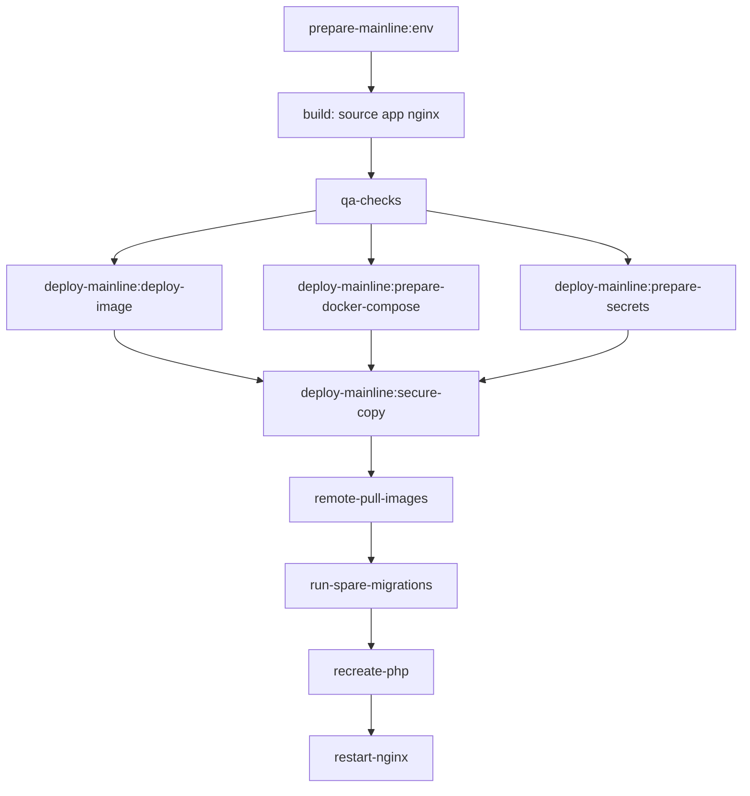

# Деплой через GitLab

## Правила веток и CI-гейт

- Pipeline запускается после push в любую ветку, но деплой выполняется только для mainline-веток: `master` и `production`.
- Для mainline перед деплоем обязательны успешные проверки:
  - `qa:php-cs-fixer`
  - `qa:phpstan`
  - `qa:rector`
  - `qa:phpunit`
  - `qa:behat`
- При падении любой QA-проверки деплой не начинается.

## Порядок деплоя на удаленный сервер

Ниже порядок, соответствующий текущему `.gitlab-ci.yml`.

### 0) Предусловия для mainline-деплоя

В CI должны быть заданы (Settings → CI/CD → Variables, флаги Protected/Masked по применимости).

**Переменные (тип Variable), проверяются `REQUIRED_VARS` в `prepare-mainline:env`:**

- `SERVER_NAME`
- `DEPLOY_USER`
- `DEPLOY_HOST`
- `DEPLOY_DIRECTORY`
- `ENV_app_secret`
- `ENV_database_password`
- `ENV_database_root_password` — root-пароль MySQL; используется при создании БД и пользователя через `phing database-deploy` и при интерполяции `${...}` в `docker-compose.deploy.yml`.
- `ENV_jwt_passphrase`
- `ENV_redis_password` — пароль Redis; на CI участвует в генерации **`secrets/redis.conf`** (Twig **`secrets/redis.conf.twig`**, **`app:generate-secrets`**) и попадает в дамп **`REDIS_URL`** для приложения. В контейнере **`redis`** на проде **нет** `environment:` с `ENV_*` — пароль только в secret **`/run/secrets/redis.conf`**, проверка готовности — **`/redis-healthcheck.sh`** (config из **`secrets/redis-healthcheck.sh`**).

**Файловые переменные (тип File), проверяются `REQUIRED_FILES`:**

- `JWT_PRIVATE_KEY`, `JWT_PUBLIC_KEY` — ключи JWT для копирования в `build/secrets/` на этапе подготовки секретов.
- `SSH_PRIVATE_KEY` — ключ для `deploy-mainline:secure-copy`.

Список обязательных имён задаётся в job `prepare-mainline:env` (см. [`.gitlab-ci.yml`](.gitlab-ci.yml)) — пайплайн падает на стадии `.pre`, если что-то не задано или файл недоступен.

**Как связаны `ENV_*`, CI и сервер:**

- В job `prepare-mainline:env` все переменные окружения с префиксом `ENV_*` записываются в артефакт **`.env.prod.local`** (dotenv-строки). Этот файл нужен дальше для **`composer symfony:dump-env prod`**: в итоговый PHP-дамп окружения попадают все prod-секреты и параметры, которые должны оказаться в **`.env.local.php`** на сервере.
- Интерполяция **`${...}`** в `docker-compose.deploy.yml` при выполнении **`docker compose … config`** на CI (job **`deploy-mainline:prepare-docker-compose`**, стадия **`deploy`**) читает значения из **окружения того же CI-job**, то есть переменные с такими именами должны быть заведены в GitLab Variables (или иначе оказаться в `printenv` раннера). Этот job **не** подтягивает артефакт **`.env.prod.local`** (он не нужен для `config`); стадии идут в порядке **`.pre` → `build` → `test` → `deploy`**, при этом **`prepare-mainline:env`** выполняется в **`.pre`**. На сервере для этого отдельный `env_file` у сервисов приложения **не используется** — на сервер уезжает уже **отрендеренный** `build/docker-compose.yml` без `${…}`.
- На сервер в каталоге релиза копируются **`build/secrets/*.pem`**, **`build/secrets/.env.local.php`** (дамп) и **`build/env.php`** (шим для Symfony, см. ниже). В [docker-compose.deploy.yml](docker-compose.deploy.yml) для `php` / `spare` заданы **Docker secrets** (файлы под `./secrets/` на хосте релиза) и **config** `env.php` → **`/srv/.env.local.php`**: небольшой файл из репозитория [`secrets/env.php`](secrets/env.php) делает `return include '/run/secrets/.env.local.php';`, чтобы Symfony Runtime загружал стандартный путь **`.env.local.php`**, а фактические значения лежали в секрете.

Также используется доступ к GitLab Container Registry через CI-токены.

### 1) Подготовка окружения (`.pre`)

Job **`prepare-mainline:env`**:

- в `before_script` проверяет наличие и непустоту всех `REQUIRED_VARS` и читаемость файлов `REQUIRED_FILES`;
- в `script` создаёт **`.env.prod.local`**: для каждой переменной `ENV_*` из окружения job добавляет строку в файл;
- сохраняет **`.env.prod.local`** как артефакт для job с `needs` на этот артефакт (например **`qa:tools`**, **`deploy-mainline:prepare-secrets`** — см. [`.gitlab-ci.yml`](.gitlab-ci.yml)).

### 2) Сборка образов и артефактов compose

На стадии **`build`** для `master`/`production` в registry собираются и пушатся:

- source image;
- app image (`prod` target);
- nginx image.

На стадии **`deploy`** (до **`deploy-mainline:secure-copy`**, см. §5):

- **`deploy-mainline:deploy-image`** — сборка и push образа из **[`docker/git`](docker/git)** (Debian, `git`, клиент OpenSSH, [`ssh_config`](docker/git/ssh_config)); тег **`$CI_GIT_IMAGE_WITH_TAG`**; этот же образ указан как **`image:`** у **`deploy-mainline:secure-copy`**.
- **`deploy-mainline:prepare-docker-compose`** — `docker compose -f docker-compose.deploy.yml config` в окружении CI, результат в **`build/docker-compose.yml`**, пути в YAML подменяются под layout на сервере.

**Prod-образ приложения (`Dockerfile`, target `prod`):**

- В первой строке [`Dockerfile`](Dockerfile) задана директива **`# syntax=docker/dockerfile:1.19`**. Она подключает актуальный Dockerfile frontend BuildKit: на раннере с образом **`docker:26`** иначе парсер не знает флаг **`COPY --exclude=...`**, и сборка падает с `unknown flag: exclude`.
- Стадия **`prod`** копирует дерево `/srv/` из source-образа с исключениями: **`.env`**, **`.env.*`**, **`.cursor`**, **`config/jwt`**, **`docs`**, **`features`**, **`secrets`**, **`tests`**. В контейнере на проде в **`/srv`** нет репозиторных dotenv-файлов и перечисленных каталогов; секреты приложения не зашиваются в образ и не подставляются через `environment:` сервиса `php` — Symfony загружает окружение из **`/srv/.env.local.php`** (config-шим) и **`/run/secrets/.env.local.php`** (дамп), см. блок выше про `configs:` / `secrets:`.

### 3) QA-блок (обязательный gate)

Перед деплоем должны успешно завершиться:

- `qa:php-cs-fixer`
- `qa:phpstan`
- `qa:rector`
- `qa:phpunit`
- `qa:behat`

### 4) Подготовка секретов для релиза (`deploy`)

Job **`deploy-mainline:prepare-secrets`** (стадия `deploy`, после QA):

- подтягивает артефакт **`.env.prod.local`** из `prepare-mainline:env` и зависимости Composer из кэша;
- выполняет **`composer symfony:dump-env prod`** (читаются `.env`, `.env.prod`, `.env.prod.local` и т.д. по правилам Symfony);
- переносит сгенерированный **`.env.local.php`** в **`build/secrets/.env.local.php`**;
- копирует в **`build/`** шим **[`secrets/env.php`](secrets/env.php)** как **`build/env.php`** (его подхватывает `configs:` в compose на сервере);
- копирует **[`secrets/redis-healthcheck.sh`](secrets/redis-healthcheck.sh)** в **`build/redis-healthcheck.sh`** (config **`redis_healthcheck`** в [docker-compose.deploy.yml](docker-compose.deploy.yml) ссылается на этот файл рядом с `docker-compose.yml` на сервере);
- копирует ключи JWT в **`build/secrets/jwt_private.pem`** и **`build/secrets/jwt_public.pem`**;
- публикует артефакт **`build/`** (каталог `secrets/`, `env.php` и `redis-healthcheck.sh` в корне `build/`).

### 5) Копирование release на удаленный сервер

Job **`deploy-mainline:secure-copy`**:

- **`image: $CI_GIT_IMAGE_WITH_TAG`** (образ из **`deploy-mainline:deploy-image`**, уже в registry);
- **`variables: GIT_STRATEGY: none`** — без checkout репозитория в job;
- в **`before_script`**: **`ssh-agent`**, **`chmod 600`** на путь File-переменной **`SSH_PRIVATE_KEY`**, **`ssh-add`** этого ключа;
- по **`needs`** ждёт успешного завершения **`deploy-mainline:deploy-image`** (**`artifacts: false`** — нужен только push образа), **`deploy-mainline:prepare-docker-compose`** (артефакт в т.ч. **`build/docker-compose.yml`**) и **`deploy-mainline:prepare-secrets`** (`build/secrets/`, **`build/env.php`**, **`build/redis-healthcheck.sh`**); содержимое **`build/`** из артефактов сливается в рабочем каталоге job;
- по SSH создаёт временный каталог `${DEPLOY_DIRECTORY}_tmp`;
- копирует туда содержимое **`build/`** (`scp -r build/*`);
- атомарно переключает директорию release: удаляет старую и переименовывает `_tmp` в `${DEPLOY_DIRECTORY}`.

На сервере рядом с `docker-compose.yml` оказываются **`env.php`**, **`redis-healthcheck.sh`** и каталог **`secrets/`** с файлами, на которые ссылаются `configs:` и `secrets:` в сгенерированном compose.

### 6) Запуск контейнеров и миграций на сервере

После переключения release на сервере выполняется:

- `docker compose pull`
- `docker compose up -d --no-recreate mysql redis`
- `docker compose up -d --force-recreate --no-deps spare`
- `docker compose exec -T spare phing database-deploy -Dapp.env=prod`
- `docker compose up -d --force-recreate --no-deps php`

Смысл `spare`: прогон миграций и сокращение downtime при деплое.

`mysql` и `redis` поднимаются явно одной командой `up -d --no-recreate` до пересоздания `spare`/`php`, чтобы Redis был доступен к моменту, когда `php-fpm` начнёт обслуживать первые HTTP-запросы (после рестарта `nginx` в шаге 7). Persistence через именованный том `redis-data` — активные пользовательские сессии переживают редеплой.

### 7) Перезапуск web-уровня

Финальный шаг:

- `docker compose stop nginx`
- `docker compose up -d nginx`

После этого новый backend-код начинает обслуживаться через nginx.

## Диаграмма CI/CD деплоя

