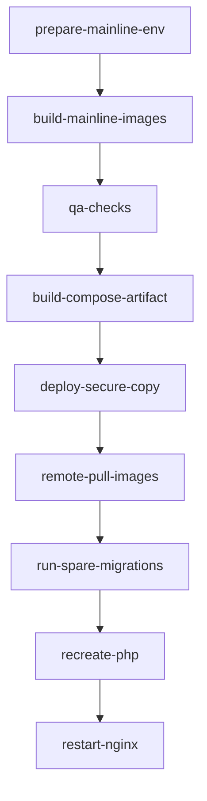

# Деплой через GitLab

## Правила веток и CI-гейт

- Pipeline запускается после push в любую ветку, но деплой выполняется только для mainline-веток: `master` и `production`.
- Для mainline перед деплоем обязательны успешные проверки:
  - `qa:php-cs-fixer`
  - `qa:phpstan`
  - `qa:rector`
  - `qa:phpunit`
  - `qa:behat`
- При падении любой QA-проверки деплой не начинается.

## Порядок деплоя на удаленный сервер

Ниже порядок, соответствующий текущему `.gitlab-ci.yml`.

### 0) Предусловия для mainline-деплоя

В CI должны быть заданы:
- `SERVER_NAME`
- `DEPLOY_USER`
- `DEPLOY_HOST`
- `DEPLOY_DIRECTORY`
- `SSH_PRIVATE_KEY`

Также используется доступ к GitLab Container Registry через CI-токены.

### 1) Подготовка окружения

Job `prepare-mainline:env`:
- собирает `.env.local` из переменных `ENV_*`;
- валидирует обязательные переменные для деплоя.

### 2) Сборка артефактов и образов

Для `master`/`production` собираются:
- Git image для deploy-шага;
- source image;
- app image (`prod` target);
- nginx image;
- сгенерированный `build/docker-compose.yml` из `docker-compose.deploy.yml`.

### 3) QA-блок (обязательный gate)

Перед деплоем должны успешно завершиться:
- `qa:php-cs-fixer`
- `qa:phpstan`
- `qa:rector`
- `qa:phpunit`
- `qa:behat`

### 4) Копирование release на удаленный сервер

Job `deploy-mainline:secure-copy`:
- по SSH создает временный каталог `${DEPLOY_DIRECTORY}_tmp`;
- копирует туда build-артефакты (`scp build/*`);
- атомарно переключает директорию release: удаляет старую и переименовывает `_tmp` в `${DEPLOY_DIRECTORY}`.

### 5) Запуск контейнеров и миграций на сервере

После переключения release на сервере выполняется:
- `docker compose pull`
- `docker compose up -d --no-recreate mysql`
- `docker compose up -d --force-recreate --no-deps spare`
- `docker compose exec -T spare phing database-deploy -Dsymfony.env=prod`
- `docker compose up -d --force-recreate --no-deps php`

Смысл `spare`: прогон миграций и сокращение downtime при деплое.

### 6) Перезапуск web-уровня

Финальный шаг:
- `docker compose stop nginx`
- `docker compose up -d nginx`

После этого новый backend-код начинает обслуживаться через nginx.

## Диаграмма CI/CD деплоя

