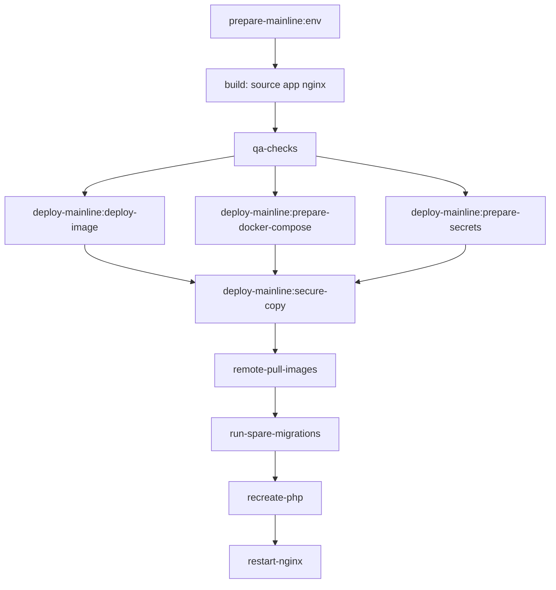

# Деплой через GitLab

Точка входа для выкладки. Канон job'ов, `script` и списков переменных —
[`.gitlab-ci.yml`](.gitlab-ci.yml). Здесь — правила гейта, имена переменных и
краткий порядок на сервере.

## Правила веток и CI-гейт

- Pipeline запускается после push в любую ветку; деплой — только для mainline:
  `master` и `production`.
- Перед mainline-деплоем обязательны успешные проверки:
  - `qa:php-cs-fixer`
  - `qa:phpstan`
  - `qa:rector`
  - `qa:phpunit`
  - `qa:behat`
  - `qa:openspec`
- При падении любой из них деплой не начинается.

## Переменные CI (mainline)

Задаются в GitLab → Settings → CI/CD → Variables (Protected/Masked по
применимости). Точные списки и fail-fast — job **`prepare-mainline:env`**
(`REQUIRED_VARS`, `REQUIRED_FILES`) в [`.gitlab-ci.yml`](.gitlab-ci.yml).

**Variable (типичный набор):**

| Имя | Назначение |
|-----|------------|
| `SERVER_NAME` | Имя сервера / окружения |
| `DEPLOY_USER` | SSH-пользователь на хосте |
| `DEPLOY_HOST` | Хост деплоя |
| `DEPLOY_DIRECTORY` | Каталог релиза на сервере |
| `ENV_app_secret` | Symfony `APP_SECRET` |
| `ENV_database_password` | Пароль БД приложения |
| `ENV_database_root_password` | Root MySQL (`phing database-deploy`, compose) |
| `ENV_jwt_passphrase` | Passphrase JWT |
| `ENV_redis_password` | Пароль Redis → secret `redis.conf` |

Хостовые пути томов (без префикса `ENV_`) — по мере появления в
`REQUIRED_VARS` (см. рецепт volume / skill `add-docker-volume`).

**File:**

| Имя | Назначение |
|-----|------------|
| `JWT_PRIVATE_KEY`, `JWT_PUBLIC_KEY` | PEM → `build/secrets/` |
| `SSH_PRIVATE_KEY` | Ключ для `deploy-mainline:secure-copy` |

**Учётная запись `DEPLOY_USER` на сервере:**

- член группы `docker` (иначе `docker compose` / `docker login` по SSH без
  лишнего `sudo`);
- `sudo` с `NOPASSWD` хотя бы для `chgrp` (gid **33** и **999**), которые
  выполняет remote script в `deploy-mainline:secure-copy` — детали в
  [`.gitlab-ci.yml`](.gitlab-ci.yml).

**Как связаны `ENV_*` и сервер (кратко):**

1. `prepare-mainline:env` пишет все `ENV_*` из окружения job в артефакт
   `.env.prod.local`.
2. `deploy-mainline:prepare-secrets` делает `composer symfony:dump-env prod` →
   дамп и секреты в `build/`.
3. На сервер уезжает отрендеренный `build/docker-compose.yml` (без `${…}`) плюс
   `configs/` и `secrets/`; Symfony читает окружение через config-шим и Docker
   secrets (см. [`docker-compose.deploy.yml`](docker-compose.deploy.yml)).

Также нужен доступ к GitLab Container Registry (CI-токены).

## Порядок деплоя (обзор)

Соответствует текущему `.gitlab-ci.yml`:

1. **`.pre`** — `prepare-mainline:env` (проверки + `.env.prod.local`).
2. **`build`** — source / app (`prod`) / nginx images → registry.
3. **`test`** — QA-гейт (включая `qa:openspec`).
4. **`deploy`** — образ для SSH-job, `compose config` → `build/docker-compose.yml`,
   подготовка секретов, `deploy-mainline:secure-copy` на сервер.
5. **На сервере** (remote script secure-copy): `pull` → поднять `mysql`/`redis`
   → recreate `spare` + `phing database-deploy` → recreate `php` → restart
   `nginx`.

Prod-образ (`Dockerfile`, target `prod`) не копирует в runtime `docs/`,
`features/`, `tests/`, `openspec/`, `patterns/`, `.claude/`, `node_modules` и репозиторные
dotenv — см. `COPY --exclude` в [`Dockerfile`](Dockerfile).

Детали скриптов, прав на `secrets/`/`configs/` и списков `chgrp` — только в
[`.gitlab-ci.yml`](.gitlab-ci.yml).
