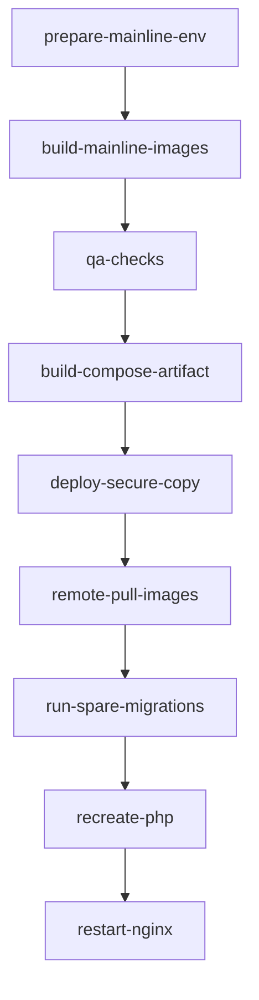

# gitlab-auto-reviewer backend

Проект backend на Symfony 8 / PHP 8.4 с локальной разработкой в Docker и деплоем через GitLab CI/CD.

## Технологический стек

- PHP `8.4`
- Symfony `8.0.*`
- MySQL `8.0`
- Docker / Docker Compose
- Composer
- Phing (инициализация, подготовка storage, миграции, deploy-команды)
- QA-инструменты: PHP CS Fixer, PHPStan, Rector, PHPUnit

## Принципы работы backend-разработчика

- Пишите и проверяйте код в Docker-контуре проекта, чтобы окружение совпадало у команды и в CI.
- Соблюдайте единый стиль кода (`.editorconfig`, `.php-cs-fixer.dist.php`) и не обходите проверки качества.
- Перед merge обязательно прогоняйте QA-набор (`php-cs-fixer`, `phpstan`, `rector`, `phpunit`).
- Любые изменения схемы БД сопровождайте корректным циклом миграций и проверкой на локальном окружении.
- Не храните production-секреты в репозитории и в коммитах. Для production используются CI-переменные и серверные env-файлы.

## Локальный цикл разработки

### 1) Первый запуск проекта

```bash
make up
make init
```

Что делает:
- `make up` поднимает контейнеры.
- `make init` запускает `phing` внутри `php`-контейнера, что приводит к:
  - подготовке хранилища (`storage-prepare`);
  - подготовке БД и миграциям (`database-deploy`).

### 2) Установка/обновление зависимостей

```bash
make deps
```

### 3) Ежедневная разработка

- Основной рабочий путь: правки кода -> локальная проверка -> коммит.
- Для ручных запусков используйте `docker compose exec php ...`.

### 4) Обязательные проверки перед merge

Полный пакет:

```bash
make qa
```

Поштучно:

```bash
make cs
make phpstan
make rector
make test
```

## Переменные окружения и конфигурация

Порядок загрузки env в Symfony:
- `.env` (базовые значения для проекта);
- `.env.local` (локальные переопределения, не коммитятся);
- `.env.$APP_ENV` и `.env.$APP_ENV.local` (по окружениям).

Ключевые backend-группы переменных:
- БД: `ENV_database_host`, `ENV_database_port`, `ENV_database_name`, `ENV_database_user`, `ENV_database_password`, `ENV_database_root_password`.
- Приложение: `ENV_secret`, `ENV_debug`.
- Почта: `ENV_mailgun_host`, `ENV_mailgun_username`, `ENV_mailgun_password`.

Важно:
- production secrets задаются через переменные CI/CD и/или на сервере, а не в репозитории;
- значения в `.env` считаются шаблонными и должны быть заменены в реальной инфраструктуре.

## Правила веток и CI-гейт

- Pipeline запускается на ветки, но деплой выполняется только для mainline-веток: `master` и `production`.
- Для mainline перед деплоем обязательны успешные проверки:
  - `qa:php-cs-fixer`
  - `qa:phpstan`
  - `qa:rector`
  - `qa:phpunit`
- При падении любой QA-проверки деплой не начинается.

## Порядок деплоя на удаленный сервер

Ниже порядок, соответствующий текущему `.gitlab-ci.yml`.

### 0) Предусловия для mainline-деплоя

В CI должны быть заданы:
- `SERVER_NAME`
- `DEPLOY_USER`
- `DEPLOY_HOST`
- `DEPLOY_DIRECTORY`
- `SSH_PRIVATE_KEY`

Также используется доступ к GitLab Container Registry через CI-токены.

### 1) Подготовка окружения

Job `prepare-mainline:env`:
- собирает `.env.local` из переменных `ENV_*`;
- валидирует обязательные переменные для деплоя.

### 2) Сборка артефактов и образов

Для `master`/`production` собираются:
- Git image для deploy-шага;
- source image;
- app image (`prod` target);
- nginx image;
- сгенерированный `build/docker-compose.yml` из `docker-compose.deploy.yml`.

### 3) QA-блок (обязательный gate)

Перед деплоем должны успешно завершиться:
- `qa:php-cs-fixer`
- `qa:phpstan`
- `qa:rector`
- `qa:phpunit`

### 4) Копирование release на удаленный сервер

Job `deploy-mainline:secure-copy`:
- по SSH создает временный каталог `${DEPLOY_DIRECTORY}_tmp`;
- копирует туда build-артефакты (`scp build/*`);
- атомарно переключает директорию release: удаляет старую и переименовывает `_tmp` в `${DEPLOY_DIRECTORY}`.

### 5) Запуск контейнеров и миграций на сервере

После переключения release на сервере выполняется:
- `docker compose pull`
- `docker compose up -d --no-recreate mysql`
- `docker compose up -d --force-recreate --no-deps spare`
- `docker compose exec -T spare phing storage-prepare database-deploy -Dsymfony.env=prod`
- `docker compose up -d --force-recreate --no-deps php`

Смысл `spare`: прогон миграций и подготовка storage до переключения основного `php` сервиса.

### 6) Перезапуск web-уровня

Финальный шаг:
- `docker compose stop nginx`
- `docker compose up -d nginx`

После этого новый backend-код начинает обслуживаться через nginx.

## Диаграмма CI/CD деплоя



## Быстрые команды

```bash
make up
make init
make deps
make qa
```
